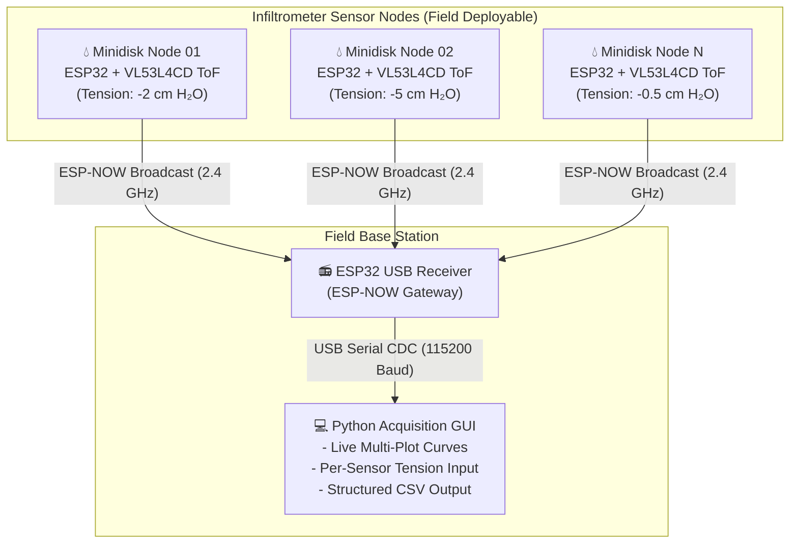

# 🌊 Slimme Minidisk — Automated Wireless Infiltrometer System

[](https://platformio.org/)
[](https://www.python.org/)
[]()
[](https://www.st.com/en/imaging-and-photonics-solutions/vl53l4cd.html)
[](LICENSE)

An automated, wireless, and modular field data acquisition system for **Mini Disk Infiltrometers** (Mariotte reservoir soil water infiltration measurements). 

By mounting a compact **Time-of-Flight (ToF) distance sensor** cap onto the infiltrometer tube and streaming sub-millimeter water meniscus readings over **ESP-NOW** to a central receiver and desktop GUI, *Slimme Minidisk* eliminates manual stopwatch timing and visual meniscus reading errors, enabling simultaneous multi-location soil hydraulic conductivity ($K(h_0)$) campaigns.

---

## 📌 Schematic View & System Architecture

<p align="center">
  
</p>

### How It Works

1. **Infiltrometer Sensor Nodes (Senders)**:
   - Each infiltrometer is fitted with a battery-powered sensor cap containing an **ESP32** microcontroller and an **STMicroelectronics VL53L4CD** Time-of-Flight infrared laser sensor.
   - The sensor points downward into the Mariotte reservoir tube and continuously measures the distance to the water surface / meniscus with sub-millimeter precision.
   - A physical button (2-second hold) and dual-blink/slow-blink LED indicator provide direct field control to start and pause measurements without opening a computer.
   - Distance, battery voltage, and status packets are broadcast wirelessly in real time over **ESP-NOW** on the 2.4 GHz band.

2. **Wireless USB Receiver**:
   - A dedicated ESP32 receiver plugged into a laptop or field computer via USB.
   - Listens for all incoming node packets within radio range (up to 100+ meters in open field) and manages an in-memory tracking table.
   - Relays parsed data and scan results over USB Serial CDC at 115200 baud.

3. **Desktop Acquisition Application (`minidisk_acquisition.py`)**:
   - A dedicated 3-screen Python GUI (Tkinter + Matplotlib) designed for field campaigns:
     - **Screen 1 (Sensor Selection)**: Discovers all active nodes, monitors signal/battery health, and lets the user check which sensors to record.
     - **Screen 2 (Campaign Dialog)**: Configures and remembers Campaign names across locations (e.g. `Morteau_2026`), records point/spot identifiers (e.g. `Plot_A_point_1`), and initializes structured CSV logs.
     - **Screen 3 (Live Multi-Sensor Curves)**: Displays individual real-time infiltration curves per sensor (with inverted Y-axis for intuitive water drop visualization) and provides dynamic per-sensor **suction tension ($h_0$) inputs in cm H₂O**.



---

## ✨ Key Features

- **Zero-Router Field Wireless (ESP-NOW)**: No WiFi routers, hotspots, or pairing required in the field. Instant connection upon power-up.
- **Sub-Millimeter Resolution**: ST VL53L4CD sensor provides high-speed, contactless distance measurements unaffected by water color or ambient light.
- **Physical Push Button & LED State Machine**:
  - **Power-On**: LED blinks twice on boot, then turns OFF into Standby.
  - **Start/Pause**: Hold the push button for 2 seconds to toggle active measurement mode (prevents accidental clicks).
  - **Measuring Indicator**: LED blinks slowly (1 Hz) while actively measuring.
  - **Water Refill / Pause**: Pausing the node clears the live graph view while preserving all historical data in CSV.
- **Interactive USB Diagnostic CLI**: Connect any node directly via USB cable to run self-tests, live I2C bus scans, sensor test reads, and pin checks.
- **Full Field Campaign App**:
  - Remembers campaign name to avoid repetitive typing across measurement spots.
  - Independent tension settings per infiltrometer ($cm\text{ }H_2O$ / $hPa$) logged in real-time with each data point.
  - Generates standardized CSV datasets ready for Zhang (1997) / Vandervaere (2000) infiltration analysis.

---

## 🛠️ Hardware & Pinout

### Bill of Materials (BOM)

| Component | Description / Specification | Quantity |
|---|---|---|
| **Microcontroller** | ESP32-C3 or ESP32-S3 DevKit / Mini | 1 per node + 1 receiver |
| **Distance Sensor** | STMicroelectronics VL53L4CD ToF Breakout | 1 per node |
| **Status LED** | 3mm or 5mm standard LED + 330Ω–1kΩ resistor | 1 per node |
| **Push Button** | Momentary tactile push button | 1 per node |
| **Power Supply** | 3.7V LiPo / 18650 cell + protected 3.3V LDO regulator | 1 per node |
| **I2C Pull-up Resistors** | 4.7 kΩ – 10 kΩ resistors to 3.3V (if not on breakout) | 2 per node |
| **3D Mount & Case** | Tube cap adapter & enclosure (in `Model/3D_print`) | 1 per node |
| **Infiltrometer** | METER Group Mini Disk Infiltrometer | 1 per node |

### Node Wiring & Pin Assignment

```
        ESP32 DevKit (Top View)
              USB-C Port
    ┌───────────────────────────┐
    │ [Left Header] [Right Header]│
    │ 3.3V          GND         │ ◄── Common Ground (Sensor, LED, Button)
    │ GND           ...         │
    │ GPIO 6        ...         │
    │ GPIO 8 (SDA)  GPIO 2      │ ◄── [BUTTON] Momentary push to GND (Hold 2s)
    │ GPIO 9 (SCL)  GPIO 1      │ ◄── [LED] Measurement Indicator (via resistor)
    └───────────────────────────┘
```

| ESP32 Pin | Connected Component | Purpose | Wiring Note |
|---|---|---|---|
| **3.3V** | VL53L4CD `VIN` / `VDD` | Sensor Power | Regulated 3.3V supply |
| **GND** | Sensor `GND`, LED (-), Button | Common Ground | Connected to common ground |
| **GPIO 8** | VL53L4CD `SDA` | I2C Data | 4.7kΩ–10kΩ pull-up to 3.3V |
| **GPIO 9** | VL53L4CD `SCL` | I2C Clock | 4.7kΩ–10kΩ pull-up to 3.3V |
| **GPIO 6** | VL53L4CD `XSHUT` / `LPn` | Hardware Standby | Active-low chip enable |
| **GPIO 1** | Measurement LED (+) | Status Indicator | Connected through 330Ω–1kΩ resistor to GND |
| **GPIO 2** | Push Button | 2s Hold Start/Pause | Uses internal `INPUT_PULLUP`, switches to GND |

---

## ⚡ Firmware Setup & Flashing

The firmware is built using **[PlatformIO](https://platformio.org/)**.

### 1. Installation

Install VS Code and the **PlatformIO IDE** extension (or PlatformIO CLI):
```powershell
python -m pip install platformio
```

### 2. Configure Sensor Node Identity

Open [`src/Esp32/include/config.h`](src/Esp32/include/config.h) and set a unique `NODE_ID` and human-readable `NODE_NAME` for each physical sensor:

```cpp
#define NODE_ID 1
#define NODE_NAME "MINIDISK_01"  // Set MINIDISK_02, MINIDISK_03, etc.
#define ESPNOW_WIFI_CHANNEL 1    // Must match receiver channel
```

### 3. Flash Receiver & Nodes

Connect your ESP32 board via USB data cable and run:

```powershell
cd src\Esp32

# 1. Flash the USB Receiver (keep connected to computer):
pio run -e receiver --target upload

# 2. Flash a Sensor Node (change NODE_ID/NAME before flashing each node):
pio run -e node --target upload
```

### 4. Interactive USB Diagnostic & Self-Test

When plugged into a computer via USB, the node provides a self-test diagnostic report in the Serial Monitor (`115200` baud):

```text
╔═════════════════════════════════════════════════════════════════════════╗
║       SLIMME MINIDISK - SENSOR NODE SELF-DIAGNOSTIC (ID 01)             ║
╚═════════════════════════════════════════════════════════════════════════╝
[SYSTEM] Node Name: MINIDISK_01 | Node ID: 1 | Firmware: v1
[SYSTEM] ESP32 Chip Model: ESP32-C3 | Free Heap: 289788 bytes
[HARDWARE] Measurement LED configured on GPIO 1 (Blinked 2x on boot)
[HARDWARE] Button configured on GPIO 2 (State: RELEASED (OK) / Raw: 1)
[I2C BUS] Pins: SDA=GPIO8, SCL=GPIO9, XSHUT=GPIO6, Speed=400 kHz

[I2C] Scanning bus: SDA=GPIO8 SCL=GPIO9 XSHUT=GPIO6
  ✓ I2C device found at address: 0x29 (VL53L4CD ToF Sensor Detected!)

[SENSOR] Testing VL53L4CD connection... ✓ SUCCESS: Sensor initialized and ranging active!
  ✓ Sample test reading: 145 mm (Status: 0)
[WIRELESS] Initializing ESP-NOW radio... ✓ OK | MAC: 70:04:1D:XX:XX:XX | Channel: 1
[WIRELESS] Broadcasting initial standby discovery packet... ✓ Sent.
```

Type any of the following interactive commands in the Serial Monitor:
- `SCAN` or `I2C`: Run live I2C bus scanner.
- `READ` or `DISTANCE`: Take an immediate single-shot distance sample.
- `START` / `STOP`: Toggle measurement mode locally.
- `LED`: Test flash indicator LED (3 blinks).
- `STATUS`: Show uptime, sequence, battery, and pin config.

---

## 💻 Desktop Campaign Acquisition App

### Install Dependencies & Launch

```powershell
# Install required Python libraries
python -m pip install pyserial matplotlib

# Launch application
cd src\Computer
python minidisk_acquisition.py
```

### The 3-Screen Workflow

```
┌───────────────────────────┐     ┌───────────────────────────┐     ┌───────────────────────────┐
│   Screen 1: Discovery     │     │    Screen 2: Campaign     │     │      Screen 3: Live       │
│  - Select Receiver Port   │ ──► │  - Campaign Name (remem.) │ ──► │  - Separate Curves/Sensor │
│  - Scan Wireless Nodes    │     │  - Location Spot Name     │     │  - Inverted Water Drop    │
│  - Check (☑) Active Nodes │     │  - Output CSV Destination │     │  - Live Tension (cm H₂O)  │
└───────────────────────────┘     └───────────────────────────┘     └───────────────────────────┘
```

1. **Screen 1 — Sensor Discovery & Selection**:
   - Plug the ESP32 receiver into your laptop, select the COM port, and click **Connect**.
   - Click **`🔍 Scan for sensors`** to display all online nodes.
   - Click the row checkboxes (**☑ / ☐**) to select which sensors will participate in the test.
   - Click **▶ Start measurement with selected sensors**.

2. **Screen 2 — Campaign & Location Dialog**:
   - Enter or select the **Campaign Name** (the dropdown automatically remembers previously entered campaign names during the session).
   - Enter the **Location / Spot** identifier (e.g. `Plot_North_Point_3`).
   - Add optional session notes, click **OK**, and choose where to save the CSV.

3. **Screen 3 — Live Multi-Sensor Measurement & Infiltration Curves**:
   - Displays individual stacked Matplotlib plots for each active sensor.
   - **Inverted Y-axis**: Plots distance going downwards as water drains into the soil, directly mirroring the physical water meniscus dropping.
   - **Independent Suction Tension Inputs**: Adjust the applied infiltrometer suction tension ($cm\text{ }H_2O$) directly under each sensor at any time; the current tension value is synchronously tagged to every data point in the CSV.
   - **Pause / Refill Awareness**: When a node is paused to refill water, its live graph clears and resets to $t=0$ for the new run, while all previous raw data remains safely stored in the CSV file.
   - Click **⏹ End measurement & save CSV** when the experiment completes.

---

## 📊 CSV Output Format

Each measurement location produces a dedicated CSV file named:  
`{campaign}_{location}_{YYYYMMDD_HHMMSS}.csv`

| Column | Example | Description |
|---|---|---|
| `timestamp` | `2026-09-15T10:14:23` | ISO 8601 acquisition timestamp |
| `campaign` | `Morteau_2026` | Campaign name |
| `location` | `Plot_A_point_1` | Specific measurement spot/point |
| `notes` | `Dry sandy loam, 20 cm depth` | User notes from dialog |
| `sensor_name` | `MINIDISK_01` | Human-readable node identity |
| `node_id` | `1` | Unique node hardware ID |
| `distance_mm` | `142` | Measured distance from sensor to water meniscus (mm) |
| `range_status` | `0` | VL53L4CD status code (`0` = Valid reading) |
| `tension_cm_h2o` | `-2` | Infiltrometer suction tension setting in cm H₂O |
| `battery_mv` | `3210` | Node battery voltage in millivolts |
| `source_mac` | `70:04:1D:4B:82:1C` | Node ESP-NOW hardware MAC address |

---

## 📂 Repository Structure

```
Slimme_minidisk/
├── Figures/                     # Schematic views, hardware photos, and diagrams
│   ├── Schematic_view.png       # Complete system overview figure
│   └── Mariotte_Cylinder.gif    # Infiltrometer suction & flow animation
├── Model/                       # 3D Mechanical CAD Files
│   ├── 3D_print/                # Ready-to-print STL files for sensor caps & cases
│   └── Fusion360/               # Parametric CAD models
├── PCB_microcontroller/         # Electronics Design
│   ├── PCB_sensor_V1..V4/       # KiCad schematics and PCB layout files
│   └── Slimme_minidisk_BOM.xlsx # Bill of Materials
├── src/
│   ├── Computer/                # Desktop Acquisition Software
│   │   ├── minidisk_acquisition.py # 3-Screen Python application (Tkinter + Matplotlib)
│   │   └── README.md            # Software documentation
│   └── Esp32/                   # ESP32 Firmware (PlatformIO)
│       ├── include/config.h     # Node configuration (Pins, IDs, Channels)
│       ├── src/main.cpp         # Node & Receiver firmware + USB Diagnostic CLI
│       └── platformio.ini       # PlatformIO build environments
└── README.md                    # Project documentation (this file)
```

---

## 🔬 Scientific Infiltration Background

The Mini Disk Infiltrometer measures soil hydraulic conductivity $K(h_0)$ under a prescribed negative pressure head (tension $h_0$). Cumulative infiltration $I(t)$ is calculated from water level drop in the Mariotte reservoir:

$$I = C_1 t + C_2 \sqrt{t}$$

Using the method of **Zhang (1997)**:

$$K(h_0) = \frac{C_1}{A}$$

where $C_1$ is the slope of cumulative infiltration vs. $\sqrt{t}$, and $A$ is a dimensionless factor relating the van Genuchten parameters of the soil type to the disk radius and suction tension $h_0$.

With *Slimme Minidisk*, distance measurements $d(t)$ logged in the CSV are converted to cumulative infiltration volume and depth automatically, providing continuous, high-resolution infiltration curves without manual intervention.

---

## 📜 License

This project is licensed under the **MIT License** — see the [LICENSE](LICENSE) file for details.
