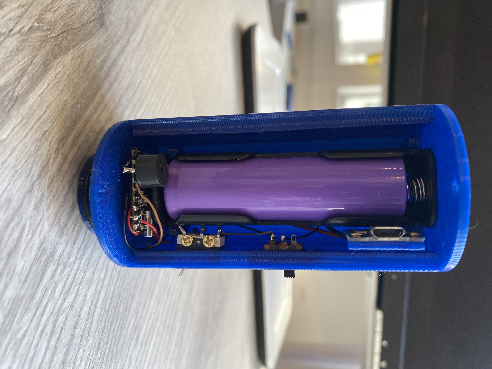

# Slimme Minidisk

**Slimme Minidisk** is a wireless data logger for [METER Mini Disk Infiltrometers](https://www.metergroup.com/). Instead of timing water level drops with a stopwatch and reading the meniscus by eye, a 3D-printed cap mounted on top of the Mariotte reservoir measures the distance to the water surface with a Time-of-Flight laser sensor (ST VL53L4CD) and sends the data wirelessly to a laptop.

One USB receiver handles several infiltrometers at once over ESP-NOW (2.4 GHz, no Wi-Fi network or pairing needed), making it practical to run multiple tension infiltrometers in parallel across a field plot.

| System overview | Sensor cap interior |
| :---: | :---: |
|  |  |

## How it works

Each sensor cap houses an **ESP32-C3 Mini**, a **VL53L4CD** distance sensor pointing down the reservoir tube, an **18650 Li-ion battery** with USB charging, a power switch, a push button, and a small buzzer:

- **1 Hz averaged readings**: The sensor samples continuously (~20 readings/s) and broadcasts one averaged water-level distance (`mm`) per second.
- **Drop-free wireless link**: Every radio packet carries the last 5 seconds of measurements, so the receiver automatically fills in missed packets if the signal briefly drops.
- **Button control in the field**: Once a session is open on the laptop, you can walk out, place each infiltrometer on the soil, and start or stop recording directly on the cap by **holding its button for 2 seconds**:
  - **1 short beep** on power-up (followed by a long beep if the VL53L4CD sensor is not detected)
  - **2 beeps** when recording starts
  - **3 beeps** when recording stops

## Hardware & wiring

| ESP32-C3 Pin | Connected part | Notes |
| :--- | :--- | :--- |
| `3.3V` / `GND` | VL53L4CD power, buzzer `-`, button | Regulated 3.3 V supply and common ground |
| `GPIO 8` | VL53L4CD `SDA` | I2C data (400 kHz) |
| `GPIO 9` | VL53L4CD `SCL` | I2C clock |
| `GPIO 6` | VL53L4CD `XSHUT` | Sensor enable |
| `GPIO 1` | Active buzzer `+` | Status beeps |
| `GPIO 2` | Push button to `GND` | Internal pull-up (`INPUT_PULLUP`), hold 2 s to toggle |

CAD models and ready-to-print STL/3MF enclosures are in [`Model/`](Model/), and KiCad PCB files are in [`PCB_microcontroller/`](PCB_microcontroller/).

## Flashing the firmware

The firmware in [`src/Esp32/`](src/Esp32/) is built with [PlatformIO](https://platformio.org/). Pre-configured environments in [`platformio.ini`](src/Esp32/platformio.ini) set the board type and `NODE_ID` automatically, so you do not need to edit `config.h` between boards:

```powershell
cd src/Esp32

# USB receiver (use receiver_s3 instead if your receiver is an ESP32-S3 DevKit)
pio run -e receiver -t upload

# Sensor nodes (each node needs a distinct ID)
pio run -e node1 -t upload   # MINIDISK_01
pio run -e node2 -t upload   # MINIDISK_02
```

Environments up to `node4` are included out of the box; copy one in `platformio.ini` if you add more sensors. For bench testing over USB serial (`115200` baud), a node accepts `STATUS`, `START`, `STOP`, and `BEEP`.

## Desktop app & field workflow

Install Python 3.9+ along with `pyserial` and `matplotlib`, then run the acquisition interface:

```powershell
python -m pip install pyserial matplotlib
python src/Computer/minidisk_acquisition.py
```

1. **Connect the receiver**: Plug in the USB receiver, pick its serial port, and click **Connect**. A green status indicator confirms the receiver heartbeat, and powered-on nodes appear automatically with their live distance and link quality.
2. **Open a session**: Click **New session…** and enter the campaign name, plot/location, optional operator/notes, and output folder (previous campaign names, operator, and folder are saved for next time).
3. **Record in the field**: Hold the button on a sensor for **2 seconds** (2 beeps) when the infiltrometer makes contact with the soil, or start it remotely from the laptop. Any sensor started with its button during an open session is added to the window automatically.
4. **Track suction tension**: Select the applied suction (`0` to `10 cm`, in `1 cm` steps) on each sensor's card. Changing the tension during a measurement updates the CSV immediately and marks the change on the live infiltration curve.
5. **Stop or refill**: Hold the button for **2 seconds** (3 beeps) to stop. Starting again on the same spot increments the `run` counter and begins a fresh curve while keeping all runs in the same session CSV.

## CSV output

Data is written live to `{campaign}_{location}_{YYYYMMDD_HHMM}.csv` (by default in `~/Documents/SlimmeMinidisk/`) while a node is recording. Each row logs:

`pc_time`, `campaign`, `location`, `operator`, `notes`, `sensor_name`, `node_id`, `run`, `seq`, `time_s`, `distance_mm`, `valid`, `range_status`, `n_avg`, `tension_cm`

From `distance_mm` vs. `time_s` and the reservoir cross-section, cumulative infiltration $I(t)$ can be fitted directly with the method of Zhang (1997) ($I = C_1 t + C_2 \sqrt{t}$) to obtain unsaturated hydraulic conductivity $K(h_0)$.

## Repository layout

- [`Figures/`](Figures/) — System schematic and hardware photos
- [`Model/`](Model/) — Fusion 360 files and 3D-printable enclosures
- [`PCB_microcontroller/`](PCB_microcontroller/) — KiCad schematics, PCB layouts, and BOM
- [`src/Esp32/`](src/Esp32/) — ESP32-C3 / ESP32-S3 node and receiver firmware
- [`src/Computer/`](src/Computer/) — Python desktop acquisition app (`minidisk_acquisition.py`)
